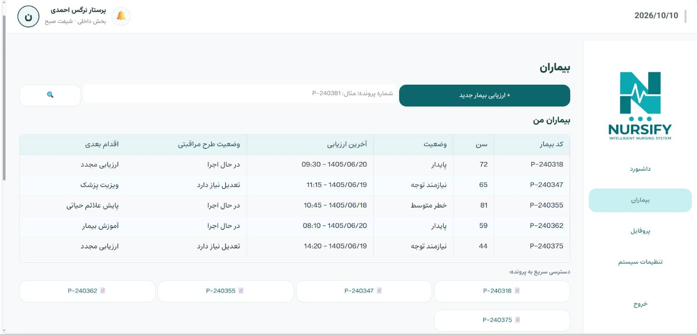
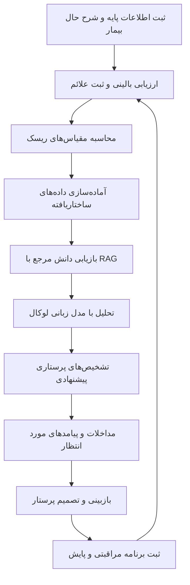
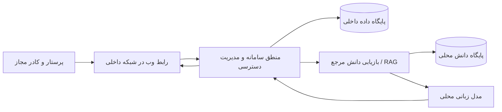

# 🩺 Nursify | نورسیفای

### سیستم هوشمند کمک‌تصمیم‌گیری پرستاری بر اساس علائم و داده‌های بالینی

**هوش مصنوعی در کنار تجربه پرستار؛ برای تصمیم‌گیری آگاهانه‌تر و مراقبت ساختاریافته‌تر**

**Nursify — Intelligent Nursing Clinical Decision Support System**

**[معرفی پروژه](#-nursify-چیست) · [قابلیت‌ها](#-قابلیتهای-کلیدی) · [تصاویر سامانه](#-نمایی-از-محصول) · [مسیر توسعه](#-مسیر-توسعه) · [همکاری](#-ارتباط-و-همکاری)**

> [!IMPORTANT]
> **Nursify در حال توسعه و ارزیابی است.** تصاویر این مخزن نمایی از نسخه توسعه‌ای سامانه هستند و ممکن است در نسخه نهایی تغییر کنند. Nursify ابزاری برای **پشتیبانی از تصمیم‌گیری پرستاری** است، نه جایگزینی برای قضاوت حرفه‌ای پرستار، نظر پزشک یا پروتکل‌های مصوب مرکز درمانی. این مخزن تنها برای معرفی پروژه ایجاد شده و **کد منبع سامانه در آن منتشر نمی‌شود**.

---

## 🎬 Nursify را در عمل ببینید

در این مخزن می‌توانید بخش‌هایی از طراحی و توسعه فعلی سامانه را مشاهده کنید؛ از مدیریت بیماران و ثبت اطلاعات بالینی تا ارزیابی ریسک و نمایش پیشنهادهای پرستاری.

**ویدئوی معرفی و دموی تعاملی:** در صورت آماده‌شدن نسخه قابل انتشار، در این بخش اضافه خواهد شد.

---

## 🚀 Nursify چیست؟

**نورسیفای (Nursify)** یک سامانه تحت وب و مبتنی بر هوش مصنوعی برای **کمک به ارزیابی بالینی، شناسایی تشخیص‌های پرستاری و پشتیبانی از تدوین برنامه مراقبتی** است.

در محیط‌های درمانی، پرستاران ناچارند اطلاعات گوناگونی مانند علائم حیاتی، شکایت بیمار، سابقه بیماری، یافته‌های معاینه، عوامل خطر و تغییرات وضعیت عمومی را در زمانی محدود بررسی کنند. در کنار این داده‌ها، انتخاب تشخیص‌ها و مداخلات مناسب نیازمند دانش تخصصی، تجربه و مراجعه به منابع معتبر است.

Nursify با هدف **سازمان‌دهی این فرایند** توسعه داده می‌شود: اطلاعات بیمار به‌شکل ساختاریافته ثبت می‌شود، ارزیابی‌های بالینی و مقیاس‌های مشخص انجام می‌گیرند و سامانه می‌تواند از طریق تحلیل هوشمند، پیشنهادهایی مرتبط با تشخیص‌های پرستاری و مراقبت مورد انتظار ارائه کند.

**اصل طراحی ما روشن است: هوش مصنوعی پیشنهاد می‌دهد، اما تصمیم حرفه‌ای و مسئولیت مراقبت بر عهده کادر درمان باقی می‌ماند.**

---

## 🎯 چه مسئله‌ای را حل می‌کنیم؟

پرستاران در محیط‌های بالینی با چالش‌های واقعی و روزمره‌ای روبه‌رو هستند:

- ⏱️ **محدودیت زمان:** فرصت کم برای مرور هم‌زمان شرح حال، علائم و منابع تخصصی.
- 🧠 **بار شناختی بالا:** نیاز به بررسی تعداد زیادی داده و احتمال نادیده‌ماندن بعضی نشانه‌های مهم.
- 📚 **دسترسی دشوار به دانش ساختاریافته:** تبدیل استانداردهای علمی به تصمیم‌های کاربردی در جریان کار بالینی.
- 🧩 **پراکندگی اطلاعات بیمار:** دشواری یکپارچه‌سازی ارزیابی‌ها، ریسک‌ها، تشخیص‌ها و اقدامات مراقبتی.
- 🔁 **نیاز به پیگیری مستمر:** اهمیت ارزیابی مجدد وضعیت بیمار و بازنگری در برنامه مراقبتی.
- 🔐 **حساسیت داده‌های سلامت:** ضرورت کنترل محل پردازش و نگهداری اطلاعات بیمار.

### رویکرد Nursify

به‌جای محدودشدن به یک جست‌وجوی ساده در کتاب‌های مرجع، هدف ما ایجاد یک **جریان کاری بالینی یکپارچه** است که از جمع‌آوری اطلاعات بیمار آغاز شود و به پیشنهاد تشخیص، مداخله، پیامد و پیگیری ساختاریافته برسد.

> هدف پروژه، کمک به کاهش زمان دسترسی به اطلاعات مرتبط، منظم‌ترشدن بررسی‌های پرستاری و پشتیبانی از تصمیم‌گیری مبتنی بر شواهد است. تحقق و میزان این مزایا باید در آزمون‌های بالینی و کاربری ارزیابی شود.

---

## 💡 چرا Nursify متفاوت است؟

### 🔒 اولویت با محرمانگی؛ معماری کاملاً لوکال

یکی از مهم‌ترین تصمیم‌های طراحی Nursify، استفاده از **پردازش هوش مصنوعی به‌صورت لوکال (Local AI)** است.

در این رویکرد، هدف این است که مدل هوش مصنوعی، داده‌های بالینی، پایگاه دانش و اجزای عملیاتی روی زیرساخت تحت کنترل مجموعه اجرا شوند؛ بنابراین **برای تحلیل اطلاعات حساس بیمار نیازی به ارسال آن‌ها به APIهای خارجی هوش مصنوعی نباشد**.

این معماری در راستای موارد زیر طراحی شده است:

- کنترل بیشتر مرکز درمانی بر محل ذخیره و پردازش اطلاعات؛
- کاهش وابستگی عملیاتی به سرویس‌های خارجی و اتصال اینترنت؛
- امکان طراحی استقرار درون‌سازمانی متناسب با الزامات هر مرکز؛
- کاهش نیاز به انتقال اطلاعات سلامت به سرویس‌های شخص ثالث؛
- امکان توسعه سیاست‌های اختصاصی مدیریت دسترسی، ثبت رخداد و حفاظت داده.

**نکته مهم:** اجرای لوکال به‌تنهایی تضمین‌کننده امنیت کامل یا انطباق قانونی نیست. احراز هویت، سطح‌بندی دسترسی، رمزنگاری، پشتیبان‌گیری، ثبت رویدادها و ممیزی امنیتی نیز از الزامات تکمیل و استقرار ایمن سامانه هستند.

### 🩺 طراحی با مشارکت تیم پرستاری

Nursify صرفاً یک پروژه نرم‌افزاری مستقل از محیط درمان نیست. **تیمی از پرستاران** در مسیر توسعه پروژه مشارکت دارد تا نیازهای واقعی کار بالینی، سناریوهای پرستاری و کیفیت پیشنهادهای خروجی مورد توجه قرار بگیرند.

بخش مهمی از فرایند ارزیابی و تکمیل پروژه شامل **بازبینی خروجی‌ها توسط پرستاران، جمع‌آوری بازخورد و اصلاح سیستم بر اساس سناریوهای بالینی** است. این بازبینی‌ها بخشی از مسیر اعتبارسنجی بوده و به معنای تکمیل اعتبارسنجی بالینی نیستند.

### 📚 ساختار مبتنی بر استانداردهای پرستاری

چارچوب دانشی پروژه بر سه طبقه‌بندی شناخته‌شده پرستاری تکیه دارد:

| استاندارد | کاربرد در Nursify |
| --- | --- |
| **NANDA-I** | چارچوب تشخیص‌های پرستاری |
| **NIC — Nursing Interventions Classification** | سازمان‌دهی مداخلات پرستاری پیشنهادی |
| **NOC — Nursing Outcomes Classification** | تعریف پیامدهای مورد انتظار و شاخص‌های ارزیابی |

هدف، نزدیک‌ترکردن فرایند تحلیل داده‌های بیمار به زبان استاندارد مراقبت پرستاری است. استفاده از منابع و محتوای دارای حق نشر، تابع مجوزها و شرایط حقوقی مربوط خواهد بود.

### 🤖 مدل زبانی و بازیابی دانش (RAG)

Nursify با بهره‌گیری از مدل‌های زبانی بزرگ (**LLM**) و رویکرد **Retrieval-Augmented Generation (RAG)** طراحی شده است تا پاسخ‌ها، به‌جای اتکای صرف به دانش درونی مدل، در صورت امکان به اطلاعات بازیابی‌شده از منابع مرجع مرتبط متکی باشند.

این رویکرد با هدف افزایش ارتباط پاسخ‌ها با دانش تخصصی و امکان بازبینی آن‌ها دنبال می‌شود؛ با این حال **RAG به‌خودی‌خود مانع خطا یا تولید اطلاعات نادرست نمی‌شود** و خروجی‌های آن نیازمند بررسی بالینی هستند.

---

## ✨ قابلیت‌های کلیدی

قابلیت‌های زیر ترکیبی از **بخش‌های قابل مشاهده در نسخه فعلی** و **جریان کاری هدف پروژه** هستند. وضعیت توسعه هر بخش ممکن است متفاوت باشد.

### 👥 ۱. داشبورد و مدیریت بیماران

نمایی متمرکز برای مشاهده فهرست بیماران، وضعیت آن‌ها، آخرین ارزیابی، وضعیت طرح مراقبتی و اقدام بعدی. رابط کاربری نمایش‌داده‌شده همچنین خلاصه‌هایی از بیماران نیازمند پیگیری، طرح‌های مراقبتی فعال و فعالیت‌های روزانه دارد.

### 🗂️ ۲. پرونده و اطلاعات پایه بیمار

ثبت اطلاعات پایه، مشخصات پذیرش و داده‌های موردنیاز برای شروع ارزیابی. طراحی فرم‌ها با هدف ایجاد ورودی‌های ساختاریافته و قابل استفاده در مراحل بعدی جریان مراقبت انجام شده است.

### 🫁 ۳. ارزیابی سیستم‌های بدن

در رابط کاربری فعلی، فرم‌های ارزیابی برای حوزه‌هایی مانند وضعیت عمومی، تنفسی، قلب و عروق، پوست، گوارش، ادراری، عضلانی‌اسکلتی و مغز و اعصاب پیش‌بینی شده‌اند تا یافته‌ها به‌صورت منظم ثبت شوند.

### 📊 ۴. ارزیابی ریسک بر اساس مقیاس‌های بالینی

در بخش ارزیابی ریسک، نمونه‌هایی از مقیاس‌های زیر دیده می‌شوند:

- **Braden:** ارزیابی خطر آسیب فشاری؛
- **Morse Fall Scale:** ارزیابی خطر سقوط؛
- **Wells DVT / PE:** ابزارهای امتیازدهی برای بررسی احتمال بالینی ترومبوز ورید عمقی یا آمبولی ریه، مطابق کاربرد و محدودیت‌های اختصاصی هر ابزار.

محاسبات و تفسیر مقیاس‌ها باید با قواعد معتبر هر ابزار و شرایط بیمار تطبیق داده شده و پیش از استفاده بالینی اعتبارسنجی شوند.

### 🧠 ۵. تحلیل هوشمند و پیشنهاد تشخیص‌های پرستاری

هسته هوشمند Nursify برای تحلیل اطلاعات جمع‌آوری‌شده و ارائه **تشخیص‌های پرستاری پیشنهادی و اولویت‌بندی‌شده** طراحی شده است.

در نمونه رابط کاربری، اولویت‌بندی بر اساس اطلاعات بیمار و شواهد ثبت‌شده نمایش داده می‌شود؛ از جمله پیشنهاد مرتبط با اختلال در تبادل گازها در یک سناریوی تنفسی آزمایشی.

### 🧾 ۶. مداخلات پیشنهادی و پیامدهای مورد انتظار

یکی از خروجی‌های اصلی موردنظر پروژه، پیوند دادن تشخیص‌های پرستاری به:

- **مداخلات پیشنهادی** با توجه به وضعیت بیمار و دانش مرجع؛
- **پیامدهای مورد انتظار** و معیارهای قابل بررسی؛
- **اطلاعات پشتیبان** برای تسهیل بررسی و بازبینی توسط پرستار.

تکمیل منطق پیشنهاددهی، کنترل کیفیت خروجی‌ها و نحوه نمایش شواهد از بخش‌های مهم توسعه و ارزیابی سامانه است.

### 🔄 ۷. برنامه مراقبتی و پایش بیمار

جریان کاری سامانه بخش‌هایی را برای طرح مراقبتی، اقدامات، پیامدها و پایش در نظر گرفته است تا اطلاعات ارزیابی و تصمیم‌گیری به یک روند قابل پیگیری متصل شوند.

### 🇮🇷 ۸. رابط کاربری فارسی و متناسب با محیط درمان

رابط کاربری **راست‌به‌چپ و فارسی** با تمرکز بر وضوح اطلاعات، ثبت مرحله‌ای و حرکت ساده میان بخش‌های مختلف طراحی شده است.

---

## 🖥️ نمایی از محصول

تصاویر زیر از رابط کاربری پروژه در مرحله توسعه تهیه شده‌اند و نمایانگر طراحی فعلی سامانه هستند.

### صفحه معرفی

### داشبورد پرستار

### فهرست بیماران

### ثبت اطلاعات بیمار

### ارزیابی ساختاریافته سیستم‌های بدن

### مقیاس‌های ارزیابی ریسک

### خروجی تحلیل و تشخیص‌های اولویت‌دار

> تصاویر حاوی اطلاعات و سناریوهای نمایشی هستند و نباید به‌عنوان خروجی اعتبارسنجی‌شده یا مدرک عملکرد بالینی سامانه تفسیر شوند.

---

## ⚙️ Nursify چگونه کار می‌کند؟

روند هدف‌گذاری‌شده سیستم را می‌توان در هفت مرحله خلاصه کرد:

**مدل هوش مصنوعی در این چرخه نقش کمک‌تصمیم‌گیر دارد؛ هیچ پیشنهاد خودکاری نباید بدون بررسی فرد متخصص مبنای اقدام درمانی قرار گیرد.**

---

## 🏗️ رویکرد معماری و حریم خصوصی

این نمودار **نمای مفهومی معماری موردنظر** را نشان می‌دهد، نه مشخصات قطعی زیرساخت تولید. انتخاب فناوری‌ها، ظرفیت سخت‌افزار و کنترل‌های امنیتی متناسب با نیاز مرکز استقرار مشخص و ارزیابی خواهند شد.

| اصل طراحی | رویکرد پروژه |
| --- | --- |
| **پردازش هوش مصنوعی** | محلی، بدون وابستگی به API خارجی برای تحلیل داده بیمار |
| **نگهداری داده‌ها** | در زیرساخت تحت کنترل سازمان |
| **دسترسی کاربران** | مبتنی بر کاربران مجاز و سیاست‌های مرکز درمانی؛ نیازمند تکمیل و ارزیابی کنترل‌ها |
| **دسترسی از سمت کاربر** | رابط وب برای استفاده در محیط تعیین‌شده |
| **پایگاه دانش** | منابع استاندارد پرستاری با رعایت مجوزهای استفاده |
| **اطمینان‌پذیری بالینی** | ارزیابی سناریومحور، بازبینی تخصصی و اصلاح مداوم |

---

## 👩‍⚕️ نقش تیم پرستاری در توسعه

توسعه یک سیستم کمک‌تصمیم‌گیری بالینی تنها با پیاده‌سازی نرم‌افزار به پایان نمی‌رسد. در Nursify، همکاری تیم فنی و تیم پرستاری بخش مهمی از مسیر محصول است.

| تیم فنی | تیم پرستاری |
| --- | --- |
| طراحی رابط و تجربه کاربری | بررسی تناسب جریان کار با محیط بالینی |
| توسعه منطق سامانه و هوش مصنوعی | پیشنهاد سناریوهای بالینی و موارد آزمون |
| پیاده‌سازی ساختار داده و بازیابی دانش | بررسی ارتباط و اولویت تشخیص‌های پیشنهادی |
| بهبود خروجی‌ها با توجه به بازخورد | ارزیابی کاربردپذیری مداخلات و پیامدها |
| بررسی عملکرد، امنیت و پایداری | ارائه بازخورد تخصصی و گزارش موارد مسئله‌دار |

هدف این همکاری، حرکت از یک نمونه فنی به سمت ابزاری قابل ارزیابی در شرایط واقعی کار پرستاری است.

---

## 📊 روش‌های رایج در برابر رویکرد Nursify

| موضوع | فرایندهای دستی یا پراکنده | رویکرد موردنظر Nursify |
| --- | --- | --- |
| جمع‌آوری داده‌های بیمار | امکان پراکندگی اطلاعات در فرم‌ها و یادداشت‌ها | ثبت مرحله‌ای و ساختاریافته |
| بررسی تشخیص‌های پرستاری | مراجعه دستی به منابع و اتکا به تجربه فردی | پیشنهادهای هوشمند برای بازبینی متخصص |
| استفاده از استانداردها | نیاز به جست‌وجو و تطبیق دستی | ارتباط هدفمند با NANDA-I، NIC و NOC |
| ارزیابی ریسک | تکمیل و محاسبه جداگانه مقیاس‌ها | فراهم‌کردن فرم‌ها و محاسبات ساختاریافته |
| تدوین برنامه مراقبتی | وابسته به فرایندها و ابزارهای موجود | تلاش برای اتصال تشخیص، اقدام و پیامد |
| حریم خصوصی در تحلیل هوشمند | وابسته به محصول و زیرساخت مورد استفاده | پردازش مبتنی بر زیرساخت لوکال |
| نقش پرستار | تصمیم‌گیر حرفه‌ای | **همچنان تصمیم‌گیر حرفه‌ای و ناظر نهایی** |

این جدول مقایسه‌ای **مفهومی** است و ادعای برتری اثبات‌شده از طریق مطالعه تطبیقی یا کارآزمایی بالینی محسوب نمی‌شود.

---

## 🏥 حوزه‌های کاربرد موردنظر

- **بخش‌های بستری بیمارستانی:** کمک به ثبت و مرور نظام‌مند داده‌های بیمار و برنامه مراقبت.
- **مراکز درمانی و پرستاری:** پشتیبانی از فرایندهای ارزیابی و پیگیری در صورت انطباق با نیاز و مقررات محل استقرار.
- **آموزش پرستاری:** بررسی سناریوها و تمرین ارتباط میان علائم، تشخیص‌ها و مداخلات، پس از آماده‌شدن امکانات مناسب آموزشی.
- **توسعه و پژوهش بالینی:** فراهم‌کردن بستری برای ارزیابی کیفیت پیشنهادهای هوشمند با داده‌های مجاز، ناشناس‌سازی‌شده یا شبیه‌سازی‌شده.

کاربردهای فوق حوزه‌های هدف پروژه هستند و به معنی تأیید رسمی سامانه برای استفاده بالینی در همه این محیط‌ها نیستند.

---

## 📍 وضعیت فعلی پروژه

**Nursify به مرحله‌ای از توسعه رسیده است که بخش‌های قابل توجهی از رابط کاربری و جریان‌های ارزیابی آن قابل نمایش‌اند، اما محصول هنوز کامل نشده و فرایند اعتبارسنجی نهایی آن به پایان نرسیده است.**

بر اساس نسخه نمایشی موجود، بخش‌هایی مانند صفحه معرفی، داشبورد پرستار، فهرست بیماران، فرم اطلاعات بیمار، ارزیابی سیستم‌های بدن، مقیاس‌های ریسک و نمایش تشخیص‌های پیشنهادی طراحی و ارائه شده‌اند.

هم‌زمان، توسعه و تکمیل منطق هوش مصنوعی، بررسی خروجی‌ها توسط تیم پرستاری، آزمون سناریوهای بیشتر، ارتقای امنیت و آماده‌سازی برای استقرار عملیاتی از محورهای مهم ادامه پروژه هستند.

> **وضعیت انتشار:** این مخزن شامل نسخه اجرایی، سورس‌کد، داده‌های بیمار، وزن مدل یا مستندات محرمانه معماری نیست.

---

## 🗺️ مسیر توسعه

### 🧩 بخش‌های قابل مشاهده در نسخه نمایشی

- [x] طراحی صفحه معرفی Nursify
- [x] طراحی داشبورد و فهرست بیماران
- [x] پیاده‌سازی رابط ثبت اطلاعات پایه و ارزیابی بیمار
- [x] نمایش رابط ارزیابی سیستم‌های بدن
- [x] نمایش رابط مقیاس‌های ارزیابی ریسک
- [x] نمایش نمونه تحلیل و تشخیص‌های پیشنهادی

> علامت‌های بالا به معنای **وجود بخش نمایشی یا رابط قابل مشاهده** هستند، نه تأیید کامل عملکرد، دقت علمی یا آمادگی تولید.

### 🚧 در حال توسعه و ارزیابی

- [ ] تکمیل و تثبیت چرخه تشخیص، مداخله و پیامد
- [ ] توسعه و بهبود اتصال به منابع استاندارد از طریق RAG
- [ ] ارزیابی کیفیت پاسخ‌های مدل لوکال در سناریوهای بالینی
- [ ] بازبینی تخصصی خروجی‌ها با مشارکت تیم پرستاری
- [ ] بررسی و اعتبارسنجی محاسبات و تفسیر مقیاس‌های بالینی
- [ ] بهبود تجربه کاربری و عملکرد سامانه
- [ ] تکمیل الزامات امنیت، سطح دسترسی و مدیریت داده

### 🔮 مراحل بعدی

- [ ] گسترش سناریوهای آزمون و مستندسازی نتایج ارزیابی
- [ ] بهبود قابلیت ردیابی مستندات و شواهد مرتبط با پیشنهادها
- [ ] تکمیل گردش کار برنامه مراقبتی و پایش
- [ ] آماده‌سازی مستندات استقرار و راهنمای کاربران
- [ ] بررسی الزامات قانونی، حرفه‌ای و سازمانی پیش از استفاده عملیاتی

**زمان‌بندی و ترتیب این مراحل ممکن است با توجه به نتایج آزمون‌های فنی و بالینی تغییر کند.**

---

## 🛡️ ایمنی بیمار و محدودیت‌های سامانه

Nursify یک پروژه **Clinical Decision Support** در حوزه پرستاری است و از ابتدا باید با ملاحظات ایمنی بیمار توسعه یابد:

1. **پیشنهاد، نه دستور درمانی:** هیچ خروجی مدل نباید جایگزین ارزیابی حضوری، قضاوت تخصصی یا پروتکل‌های بالینی شود.
2. **احتمال خطای هوش مصنوعی:** مدل ممکن است تشخیص نامرتبط، پیشنهاد ناقص یا توضیح نادرست ارائه کند؛ حتی در صورت استفاده از RAG.
3. **نیاز به اعتبارسنجی:** دقت تشخیص‌ها، تناسب مداخلات، عملکرد مقیاس‌ها و قابلیت اطمینان سامانه باید به‌صورت مستقل ارزیابی شوند.
4. **محرمانگی داده‌ها:** از انتشار اطلاعات شناسایی‌کننده بیمار در تصاویر، گزارش‌ها، مخازن عمومی یا محیط‌های نمایشی باید جلوگیری شود.
5. **کنترل‌های سازمانی:** استقرار عملیاتی منوط به اجرای الزامات امنیتی، حقوقی و حرفه‌ای مربوط به محیط استفاده است.

**تا زمان تکمیل آزمون‌ها، ارزیابی تخصصی و اخذ مجوزهای احتمالی موردنیاز، این محصول نباید به‌عنوان یک سیستم مستقل و تأییدشده برای تصمیم‌گیری بالینی معرفی یا استفاده شود.**

---

## ❓ پرسش‌های متداول

### آیا Nursify یک چت‌بات عمومی پزشکی است؟

خیر. هدف Nursify ساخت یک **جریان کاری تخصصی کمک‌تصمیم‌گیری پرستاری** با داده‌های ساختاریافته بیمار، ارزیابی‌های بالینی و ارتباط با استانداردهای پرستاری است؛ نه صرفاً یک رابط گفت‌وگو با مدل زبانی.

### آیا هوش مصنوعی Nursify به اینترنت یا API خارجی نیاز دارد؟

معماری هدف و رویکرد فعلی پروژه **Local-first** است و برای تحلیل داده‌های بیمار، بر اجرای مدل در زیرساخت داخلی تکیه دارد. استقرار نهایی و سطح استقلال شبکه‌ای متناسب با زیرساخت مقصد آزموده و مستندسازی خواهد شد.

### آیا اطلاعات بیماران برای آموزش مدل در اختیار سرویس‌های خارجی قرار می‌گیرد؟

خیر؛ ارسال داده‌های حساس بیمار به سرویس‌های هوش مصنوعی خارجی بخشی از معماری موردنظر پروژه نیست. هر نوع استفاده از داده واقعی باید تحت ضوابط محرمانگی، مجوز و سیاست‌های مرکز درمانی انجام شود.

### آیا Nursify جایگزین پرستار یا پزشک می‌شود؟

خیر. این پروژه برای **کمک به تصمیم‌گیری و سازمان‌دهی مراقبت** طراحی شده است. تصمیم نهایی و مسئولیت حرفه‌ای همچنان با کادر درمان است.

### آیا تشخیص‌های Nursify قطعی هستند؟

خیر. تشخیص‌های ارائه‌شده **پیشنهادی** هستند و ممکن است اشتباه یا ناقص باشند. آن‌ها باید بر اساس وضعیت واقعی بیمار و توسط فرد متخصص بررسی شوند.

### آیا مقیاس‌های Braden، Morse و Wells در سامانه وجود دارند؟

بخش‌های مربوط به این ابزارها در رابط نسخه نمایشی قابل مشاهده‌اند. صحت محاسبات، محدوده کاربرد و تفسیر نتایج آن‌ها باید قبل از استفاده بالینی به‌طور مستقل بررسی شوند.

### چه کسانی در توسعه محصول مشارکت دارند؟

تیم فنی پروژه در کنار **تیم پرستاری** روی طراحی و توسعه کار می‌کند. مشارکت پرستاران در تعریف سناریوها، بازبینی خروجی‌ها و ارائه بازخورد تخصصی در نظر گرفته شده است.

### آیا Nursify متن‌باز است؟

خیر. **Nursify یک پروژه خصوصی است.** این ریپازیتوری فقط برای معرفی محصول، ارائه تصاویر و نمایش مسیر توسعه ایجاد شده و شامل سورس‌کد اصلی، مدل‌ها یا داده‌های خصوصی نیست.

### آیا Nursify آماده استفاده در بیمارستان است؟

پروژه در حال توسعه و ارزیابی است. آمادگی برای استفاده بالینی تنها پس از تکمیل آزمون‌ها، کنترل‌های امنیتی، ارزیابی تخصصی و رعایت الزامات سازمانی و قانونی قابل بررسی خواهد بود.

### آیا امکان همکاری با پروژه وجود دارد؟

هدف این مخزن معرفی Nursify و تسهیل آشنایی علاقه‌مندان، متخصصان پرستاری، پژوهشگران و مراکز درمانی با مسیر توسعه آن است. راه ارتباطی رسمی تیم پس از تعیین، در بخش پایین درج می‌شود.

---

## 📬 ارتباط و همکاری

اگر در حوزه‌های **پرستاری، هوش مصنوعی پزشکی، ارزیابی سیستم‌های کمک‌تصمیم‌گیری، امنیت داده‌های سلامت یا استقرار نرم‌افزار در مراکز درمانی** فعالیت می‌کنید و به این پروژه علاقه‌مند هستید، از فرصت گفت‌وگو و همکاری استقبال می‌کنیم.

**📩 راه ارتباطی:** *[ایمیل یا راه ارتباطی رسمی تیم را اینجا وارد کنید]*

**🌐 وب‌سایت یا دموی عمومی:** *[در صورت انتشار نسخه قابل نمایش، لینک را اینجا قرار دهید]*

> **Nursify — فناوری در خدمت دانش پرستاری و مراقبت مسئولانه‌تر.**

---

## 🔐 مالکیت فکری و وضعیت مخزن

این ریپازیتوری یک **Showcase / Portfolio Repository** برای معرفی پروژه خصوصی Nursify است.

- **هیچ بخشی از کد منبع اصلی پروژه در این مخزن منتشر نشده است.**
- تصاویر و توضیحات جهت معرفی پروژه و نمایش قابلیت‌های در حال توسعه ارائه شده‌اند.
- انتشار این محتوا به معنای اعطای مجوز استفاده از نرم‌افزار، مدل‌ها، پایگاه داده یا سایر دارایی‌های اختصاصی پروژه نیست.
- استفاده تجاری، بازنشر یا بهره‌برداری از دارایی‌های اختصاصی پروژه منوط به کسب مجوز از صاحبان حقوق مربوط است.
- حقوق منابع تخصصی و استانداردهای شخص ثالث، از جمله NANDA-I، NIC و NOC، متعلق به صاحبان قانونی آن‌هاست و مشمول شرایط مجوز مربوطه است.

**© Nursify Project Team — All rights reserved, subject to third-party rights.**
