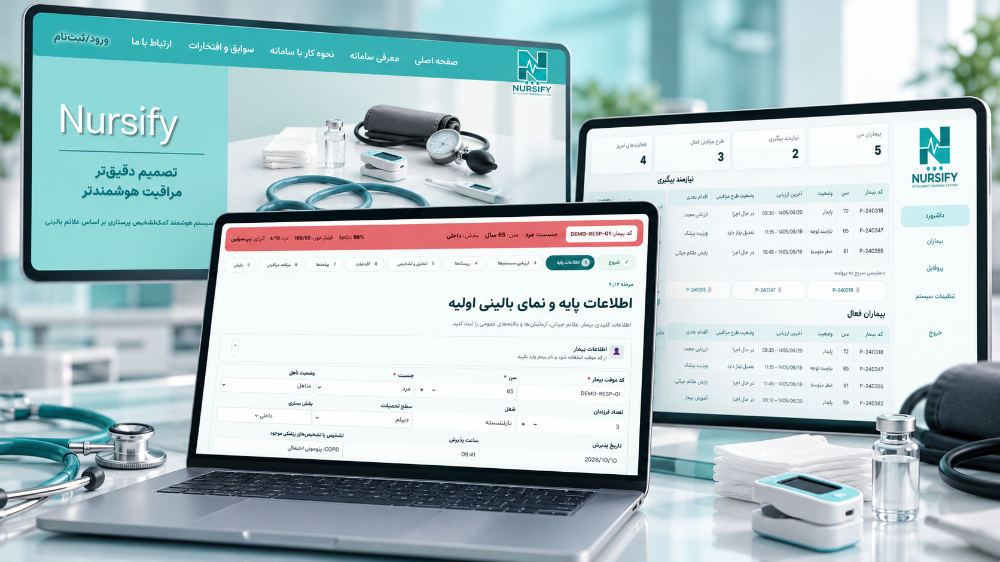
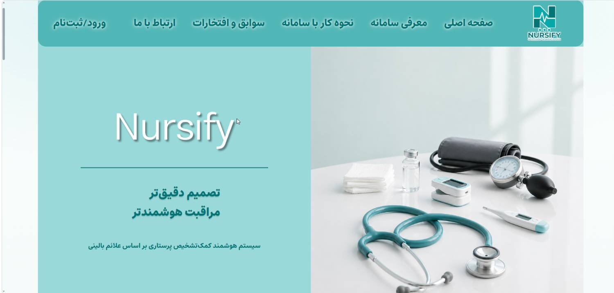
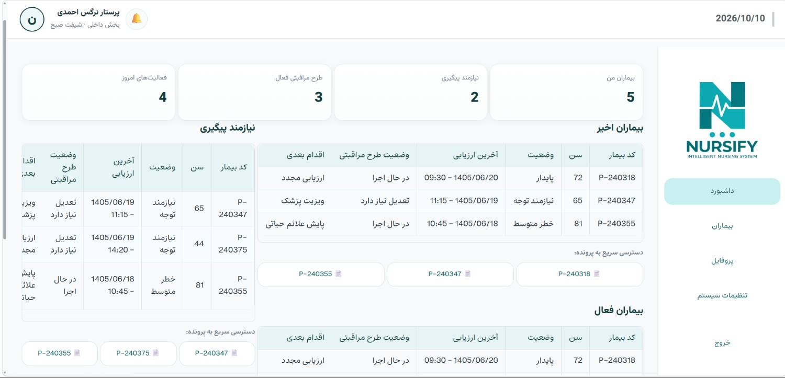
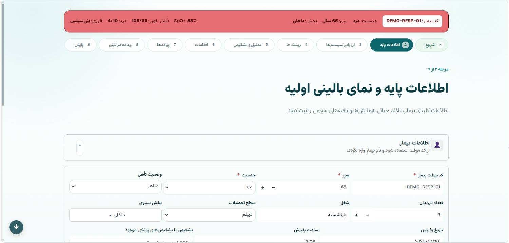
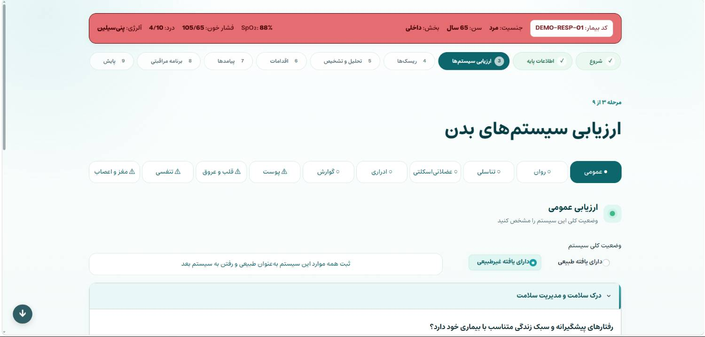
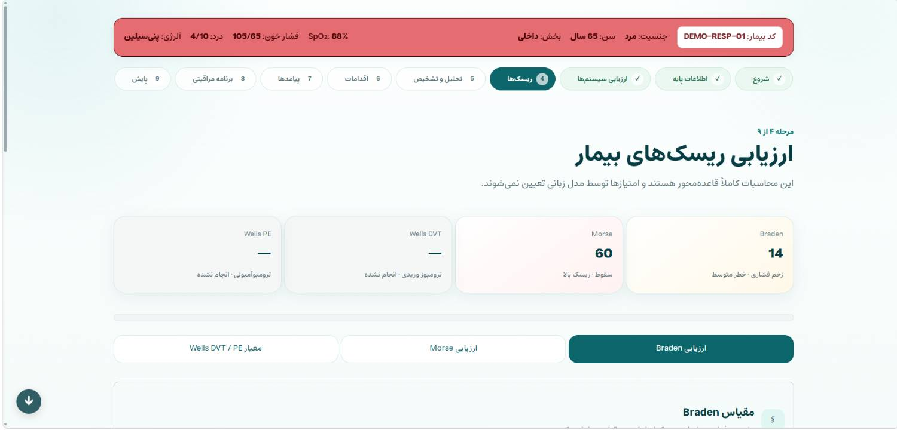
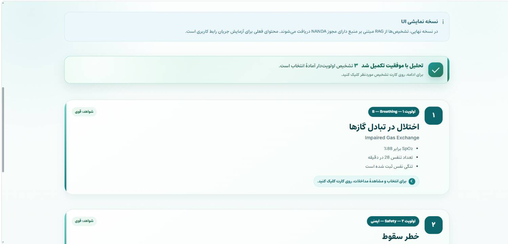

# 🩺 Nursify

### سیستم هوشمند کمک‌تصمیم‌گیری پرستاری بر اساس علائم و داده‌های بالینی

**هوش مصنوعی در کنار تجربه پرستار؛ برای تصمیم‌گیری آگاهانه‌تر و مراقبت ساختاریافته‌تر**

**Nursify — Intelligent Nursing Clinical Decision Support System**

<!--

-->
<!--
**[معرفی پروژه](#-nursify-چیست) · [قابلیت‌ها](#-قابلیتهای-کلیدی) · [تصاویر سامانه](#-نمایی-از-محصول) · [مسیر توسعه](#-مسیر-توسعه) · [همکاری](#-ارتباط-و-همکاری)**
-->

<!--
> [!IMPORTANT]
> **Nursify در حال توسعه و ارزیابی است.** تصاویر این مخزن نمایی از نسخه توسعه‌ای سامانه هستند و ممکن است در نسخه نهایی تغییر کنند. Nursify ابزاری برای **پشتیبانی از تصمیم‌گیری پرستاری** است، نه جایگزینی برای قضاوت حرفه‌ای پرستار، نظر پزشک یا پروتکل‌های مصوب مرکز درمانی. این مخزن تنها برای معرفی پروژه ایجاد شده و **کد منبع سامانه در آن منتشر نمی‌شود**.-->

---

## 🎬 Nursify را در عمل ببینید

<!--
**ویدئوی معرفی و دموی تعاملی:** در صورت آماده‌شدن نسخه قابل انتشار، در این بخش اضافه خواهد شد.

-->
---

## 🚀 Nursify چیست؟

**نرسیفای (Nursify)** یک سامانه تحت وب و مبتنی بر هوش مصنوعی برای **کمک به ارزیابی بالینی، شناسایی تشخیص‌های پرستاری و پشتیبانی از تدوین برنامه مراقبتی** است.

در محیط‌های درمانی، پرستاران ناچارند اطلاعات گوناگونی مانند علائم حیاتی، شکایت بیمار، سابقه بیماری، یافته‌های معاینه، عوامل خطر و تغییرات وضعیت عمومی را در زمانی محدود بررسی کنند. در کنار این داده‌ها، انتخاب تشخیص‌ها و مداخلات مناسب نیازمند دانش تخصصی، تجربه و مراجعه به منابع معتبر است.
.
پروژه Nursify با هدف **سازمان‌دهی این فرایند** توسعه داده می‌شود: اطلاعات بیمار به‌شکل ساختاریافته ثبت می‌شود، ارزیابی‌های بالینی و مقیاس‌های مشخص انجام می‌گیرند و سامانه می‌تواند از طریق تحلیل هوشمند، پیشنهادهایی مرتبط با تشخیص‌های پرستاری و مراقبت مورد انتظار ارائه کند.

---

## 🎯 چه مسئله‌ای را حل می‌کنیم؟

پرستاران در محیط‌های بالینی با چالش‌های واقعی و روزمره‌ای روبه‌رو هستند:

- ⏱️ **محدودیت زمان:** فرصت کم برای مرور هم‌زمان شرح حال، علائم و منابع تخصصی.
- 🧠 **بار شناختی بالا:** نیاز به بررسی تعداد زیادی داده و احتمال نادیده‌ماندن بعضی نشانه‌های مهم.
- 📚 **دسترسی دشوار به دانش ساختاریافته:** تبدیل استانداردهای علمی به تصمیم‌های کاربردی در جریان کار بالینی.
- 🧩 **پراکندگی اطلاعات بیمار:** دشواری یکپارچه‌سازی ارزیابی‌ها، ریسک‌ها، تشخیص‌ها و اقدامات مراقبتی.
- 🔁 **نیاز به پیگیری مستمر:** اهمیت ارزیابی مجدد وضعیت بیمار و بازنگری در برنامه مراقبتی.
- 🔐 **حساسیت داده‌های سلامت:** ضرورت کنترل محل پردازش و نگهداری اطلاعات بیمار.

### رویکرد Nursify

به‌جای محدودشدن به یک جست‌وجوی ساده در کتاب‌های مرجع، هدف ما ایجاد یک **جریان کاری بالینی یکپارچه** است که از جمع‌آوری اطلاعات بیمار آغاز شود و به پیشنهاد تشخیص، مداخله، پیامد و پیگیری ساختاریافته برسد.

---

## 💡 چرا Nursify متفاوت است؟

### 🔒 اولویت با محرمانگی 
<!--
یکی از مهم‌ترین تصمیم‌های طراحی Nursify، استفاده از **پردازش هوش مصنوعی به‌صورت لوکال (Local AI)** است.

در این رویکرد، هدف این است که مدل هوش مصنوعی، داده‌های بالینی، پایگاه دانش و اجزای عملیاتی روی زیرساخت تحت کنترل مجموعه اجرا شوند؛ بنابراین **برای تحلیل اطلاعات حساس بیمار نیازی به ارسال آن‌ها به APIهای خارجی هوش مصنوعی نباشد**.
-->
معماری در راستای موارد زیر طراحی شده است:

- کنترل بیشتر مرکز درمانی بر محل ذخیره و پردازش اطلاعات؛
- کاهش وابستگی عملیاتی به سرویس‌های خارجی و اتصال اینترنت؛
- امکان طراحی استقرار درون‌سازمانی متناسب با الزامات هر مرکز؛

### طراحی‌شده برای پرستاران فارسی‌زبان

یکی از اهداف اصلی Nursify، توسعه یک دستیار هوشمند پرستاری متناسب با نیازهای پرستاران فارسی‌زبان است.
با وجود منابع و استانداردهای معتبر بین‌المللی پرستاری، استفاده سریع و کاربردی از این دانش در محیط‌های بالینی فارسی‌زبان همواره ساده نیست.
Nursify با تمرکز بر زبان فارسی، اصطلاحات تخصصی پرستاری و نیازهای واقعی محیط‌های درمانی ایران توسعه می‌یابد تا پرستاران بتوانند اطلاعات بیمار را به زبان فارسی ثبت کرده و پیشنهادهای پرستاری را در محیطی آشنا و قابل فهم دریافت کنند.
هدف ما این است که دانش استاندارد و بین‌المللی پرستاری را از طریق یک ابزار هوشمند، بومی و کاربردی در دسترس پرستاران فارسی‌زبان قرار دهیم.

### 🩺 طراحی با مشارکت تیم پرستاری

پروژه Nursify صرفاً یک پروژه نرم‌افزاری مستقل از محیط درمان نیست. **تیمی از پرستاران** در مسیر توسعه پروژه مشارکت دارد تا نیازهای واقعی کار بالینی، سناریوهای پرستاری و کیفیت پیشنهادهای خروجی مورد توجه قرار بگیرند.
بخش مهمی از فرایند ارزیابی و تکمیل پروژه شامل **بازبینی خروجی‌ها توسط پرستاران، جمع‌آوری بازخورد و اصلاح سیستم بر اساس سناریوهای بالینی** است.

### 📚 ساختار مبتنی بر استانداردهای پرستاری

چارچوب دانشی پروژه بر مراجع طبقه‌بندی شناخته‌شده پرستاری تکیه دارد.
<!--
| استاندارد | کاربرد در Nursify |
| --- | --- |
| **NANDA-I** | چارچوب تشخیص‌های پرستاری |
| **NIC — Nursing Interventions Classification** | سازمان‌دهی مداخلات پرستاری پیشنهادی |
| **NOC — Nursing Outcomes Classification** | تعریف پیامدهای مورد انتظار و شاخص‌های ارزیابی |
-->

## ✨ قابلیت‌های کلیدی

قابلیت‌های زیر ترکیبی از **بخش‌های قابل مشاهده در نسخه فعلی** و **جریان کاری هدف پروژه** هستند.

### 👥 ۱. داشبورد و مدیریت بیماران

نمایی متمرکز برای مشاهده فهرست بیماران، وضعیت آن‌ها، آخرین ارزیابی، وضعیت طرح مراقبتی و اقدام بعدی. رابط کاربری نمایش‌داده‌شده همچنین خلاصه‌هایی از بیماران نیازمند پیگیری، طرح‌های مراقبتی فعال و فعالیت‌های روزانه دارد.

### 🗂️ ۲. پرونده و اطلاعات پایه بیمار

ثبت اطلاعات پایه، مشخصات پذیرش و داده‌های موردنیاز برای شروع ارزیابی. طراحی فرم‌ها با هدف ایجاد ورودی‌های ساختاریافته و قابل استفاده در مراحل بعدی جریان مراقبت انجام شده است.

### 🫁 ۳. ارزیابی سیستم‌های بدن

در رابط کاربری فعلی، فرم‌های ارزیابی برای حوزه‌هایی مانند وضعیت عمومی، تنفسی، قلب و عروق، پوست، گوارش، ادراری، عضلانی‌اسکلتی و مغز و اعصاب پیش‌بینی شده‌اند تا یافته‌ها به‌صورت منظم ثبت شوند.

### 📊 ۴. ارزیابی ریسک بر اساس مقیاس‌های بالینی

در بخش ارزیابی ریسک، نمونه‌هایی از مقیاس‌های زیر دیده می‌شوند:

- **Braden:** ارزیابی خطر آسیب فشاری؛
- **Morse Fall Scale:** ارزیابی خطر سقوط؛
- **Wells DVT / PE:** ابزارهای امتیازدهی برای بررسی احتمال بالینی ترومبوز ورید عمقی یا آمبولی ریه، مطابق کاربرد و محدودیت‌های اختصاصی هر ابزار.

محاسبات و تفسیر مقیاس‌ها باید با قواعد معتبر هر ابزار و شرایط بیمار تطبیق داده شده و پیش از استفاده بالینی اعتبارسنجی شوند.

### 🧠 ۵. تحلیل هوشمند و پیشنهاد تشخیص‌های پرستاری

هسته هوشمند Nursify برای تحلیل اطلاعات جمع‌آوری‌شده و ارائه **تشخیص‌های پرستاری پیشنهادی و اولویت‌بندی‌شده** طراحی شده است.

در نمونه رابط کاربری، اولویت‌بندی بر اساس اطلاعات بیمار و شواهد ثبت‌شده نمایش داده می‌شود؛ از جمله پیشنهاد مرتبط با اختلال در تبادل گازها در یک سناریوی تنفسی آزمایشی.

### 🧾 ۶. مداخلات پیشنهادی و پیامدهای مورد انتظار

یکی از خروجی‌های اصلی موردنظر پروژه، پیوند دادن تشخیص‌های پرستاری به:

- **مداخلات پیشنهادی** با توجه به وضعیت بیمار و دانش مرجع؛
- **پیامدهای مورد انتظار** و معیارهای قابل بررسی؛
- **اطلاعات پشتیبان** برای تسهیل بررسی و بازبینی توسط پرستار.

### 🔄 ۷. برنامه مراقبتی و پایش بیمار

جریان کاری سامانه بخش‌هایی را برای طرح مراقبتی، اقدامات، پیامدها و پایش در نظر گرفته است تا اطلاعات ارزیابی و تصمیم‌گیری به یک روند قابل پیگیری متصل شوند.

###  ۸. رابط کاربری فارسی و متناسب با محیط درمان

رابط کاربری با تمرکز بر وضوح اطلاعات، ثبت مرحله‌ای و حرکت ساده میان بخش‌های مختلف طراحی شده است.

---

## 🖥️ نمایی از محصول

---

<!--
روند هدف‌گذاری‌شده سیستم را می‌توان در هفت مرحله خلاصه کرد:

-->

---
-->
## 📊 روش‌های رایج در برابر رویکرد Nursify

| موضوع | فرایندهای دستی یا پراکنده | رویکرد موردنظر Nursify |
| --- | --- | --- |
| جمع‌آوری داده‌های بیمار | امکان پراکندگی اطلاعات در فرم‌ها و یادداشت‌ها | ثبت مرحله‌ای و ساختاریافته |
| بررسی تشخیص‌های پرستاری | مراجعه دستی به منابع و اتکا به تجربه فردی | پیشنهادهای هوشمند برای بازبینی متخصص |
| استفاده از استانداردها | نیاز به جست‌وجو و تطبیق دستی | ارتباط هدفمند با مراجع شناخته شده |
| ارزیابی ریسک | تکمیل و محاسبه جداگانه مقیاس‌ها | فراهم‌کردن فرم‌ها و محاسبات ساختاریافته |
| تدوین برنامه مراقبتی | وابسته به فرایندها و ابزارهای موجود | تلاش برای اتصال تشخیص، اقدام و پیامد |
| حریم خصوصی در تحلیل هوشمند | وابسته به محصول و زیرساخت مورد استفاده | پردازش مبتنی بر زیرساخت لوکال |
| نقش پرستار | تصمیم‌گیر حرفه‌ای | **همچنان تصمیم‌گیر حرفه‌ای و ناظر نهایی** |

---

## 🏥 حوزه‌های کاربرد موردنظر

- **بخش‌های بستری بیمارستانی:** کمک به ثبت و مرور نظام‌مند داده‌های بیمار و برنامه مراقبت.
- **مراکز درمانی و پرستاری:** پشتیبانی از فرایندهای ارزیابی و پیگیری در صورت انطباق با نیاز و مقررات محل استقرار.
- **آموزش پرستاری:** بررسی سناریوها و تمرین ارتباط میان علائم، تشخیص‌ها و مداخلات، پس از آماده‌شدن امکانات مناسب آموزشی.
- **توسعه و پژوهش بالینی:** فراهم‌کردن بستری برای ارزیابی کیفیت پیشنهادهای هوشمند با داده‌های مجاز، ناشناس‌سازی‌شده یا شبیه‌سازی‌شده.

---

## 📍 وضعیت فعلی پروژه

**Nursify به مرحله‌ای از توسعه رسیده است که بخش‌های قابل توجهی از رابط کاربری و جریان‌های ارزیابی آن قابل نمایش‌اند، اما محصول هنوز کامل نشده و فرایند اعتبارسنجی نهایی آن به پایان نرسیده است.**

---
<!--
### 🚧 در حال توسعه و ارزیابی

- [ ] تکمیل و تثبیت چرخه تشخیص، مداخله و پیامد
- [ ] توسعه و بهبود اتصال به منابع استاندارد از طریق RAG
- [ ] ارزیابی کیفیت پاسخ‌های مدل لوکال در سناریوهای بالینی
- [ ] بازبینی تخصصی خروجی‌ها با مشارکت تیم پرستاری
- [ ] بررسی و اعتبارسنجی محاسبات و تفسیر مقیاس‌های بالینی
- [ ] بهبود تجربه کاربری و عملکرد سامانه
- [ ] تکمیل الزامات امنیت، سطح دسترسی و مدیریت داده

### 🔮 مراحل بعدی

- [ ] گسترش سناریوهای آزمون و مستندسازی نتایج ارزیابی
- [ ] بهبود قابلیت ردیابی مستندات و شواهد مرتبط با پیشنهادها
- [ ] تکمیل گردش کار برنامه مراقبتی و پایش
- [ ] آماده‌سازی مستندات استقرار و راهنمای کاربران
- [ ] بررسی الزامات قانونی، حرفه‌ای و سازمانی پیش از استفاده عملیاتی

**زمان‌بندی و ترتیب این مراحل ممکن است با توجه به نتایج آزمون‌های فنی و بالینی تغییر کند.**
-->
---

## ❓ پرسش‌های متداول
<!--
### آیا Nursify یک چت‌بات عمومی پزشکی است؟

خیر. هدف Nursify ساخت یک **جریان کاری تخصصی کمک‌تصمیم‌گیری پرستاری** با داده‌های ساختاریافته بیمار، ارزیابی‌های بالینی و ارتباط با استانداردهای پرستاری است؛ نه صرفا یک رابط گفت‌وگو با مدل زبانی.

### آیا هوش مصنوعی Nursify به اینترنت یا API خارجی نیاز دارد؟

معماری هدف و رویکرد فعلی پروژه **Local-first** است و برای تحلیل داده‌های بیمار، بر اجرای مدل در زیرساخت داخلی تکیه دارد. استقرار نهایی و سطح استقلال شبکه‌ای متناسب با زیرساخت مقصد آزموده و مستندسازی خواهد شد.

### آیا اطلاعات بیماران برای آموزش مدل در اختیار سرویس‌های خارجی قرار می‌گیرد؟

خیر؛ ارسال داده‌های حساس بیمار به سرویس‌های هوش مصنوعی خارجی بخشی از معماری موردنظر پروژه نیست. هر نوع استفاده از داده واقعی تحت ضوابط محرمانگی، مجوز و سیاست‌های مرکز درمانی انجام می‌شود.
-->
### آیا Nursify جایگزین پرستار یا پزشک می‌شود؟

خیر. این پروژه برای **کمک به تصمیم‌گیری و سازمان‌دهی مراقبت** طراحی شده است. تصمیم نهایی و مسئولیت حرفه‌ای همچنان با کادر درمان است..

### چه کسانی در توسعه محصول مشارکت دارند؟

تیم فنی پروژه در کنار **تیم پرستاری** روی طراحی و توسعه کار می‌کند. مشارکت پرستاران در تعریف سناریوها، بازبینی خروجی‌ها و ارائه بازخورد تخصصی در نظر گرفته شده است.

### آیا Nursify متن‌باز است؟

خیر. **Nursify یک پروژه خصوصی است.** این ریپازیتوری فقط برای معرفی محصول، ارائه تصاویر و نمایش مسیر توسعه ایجاد شده و شامل سورس‌کد اصلی، مدل‌ها یا داده‌های خصوصی نیست.

### آیا Nursify آماده استفاده در بیمارستان است؟

پروژه در حال توسعه و ارزیابی است. آمادگی برای استفاده بالینی تنها پس از تکمیل آزمون‌ها، کنترل‌های امنیتی، ارزیابی تخصصی و رعایت الزامات سازمانی و قانونی قابل بررسی خواهد بود.

### آیا امکان همکاری با پروژه وجود دارد؟

هدف این مخزن معرفی Nursify و تسهیل آشنایی علاقه‌مندان، متخصصان پرستاری، پژوهشگران و مراکز درمانی با مسیر توسعه آن است. راه ارتباطی رسمی تیم، درج خواهد شد.

---

## 📬 ارتباط و همکاری

اگر در حوزه‌های **پرستاری، هوش مصنوعی پزشکی، ارزیابی سیستم‌های کمک‌تصمیم‌گیری، امنیت داده‌های سلامت یا استقرار نرم‌افزار در مراکز درمانی** فعالیت می‌کنید و به این پروژه علاقه‌مند هستید، از فرصت گفت‌وگو و همکاری استقبال می‌کنیم.

**📩 راه ارتباطی:** *shamsi84sh@gmail.com*

>
---

## 🔐 مالکیت فکری و وضعیت مخزن

پروژه Nursify یک پروژه خصوصی است.
کد منبع، فایل‌ها، دارایی‌های گرافیکی، محیط‌های مجازی و سایر محتویات پروژه متعلق به صاحب پروژه بوده و بدون اجازه صریح مالک، مجاز به بازتوزیع، تغییر یا استفاده تجاری نیستند.
